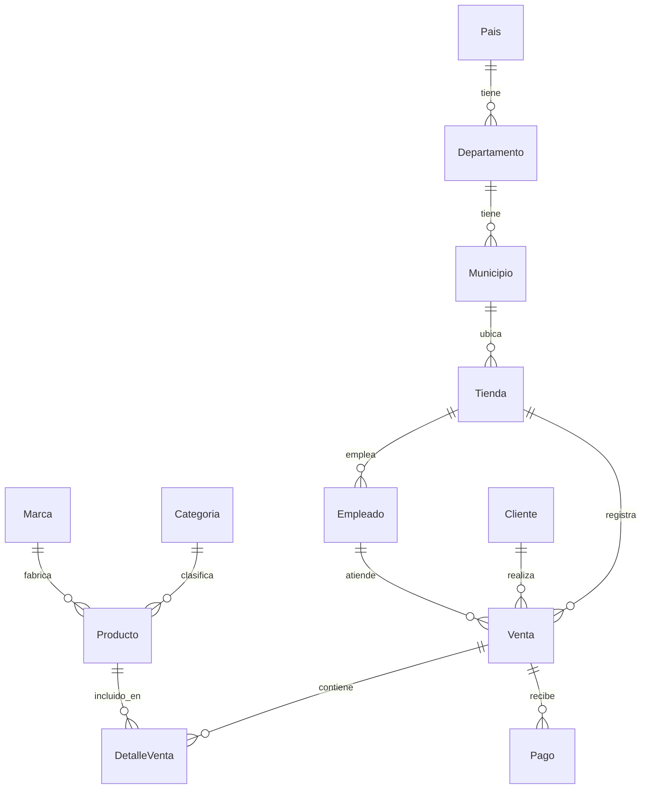
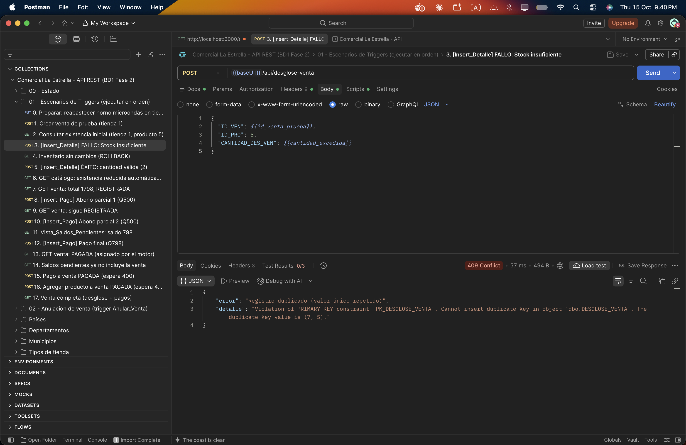
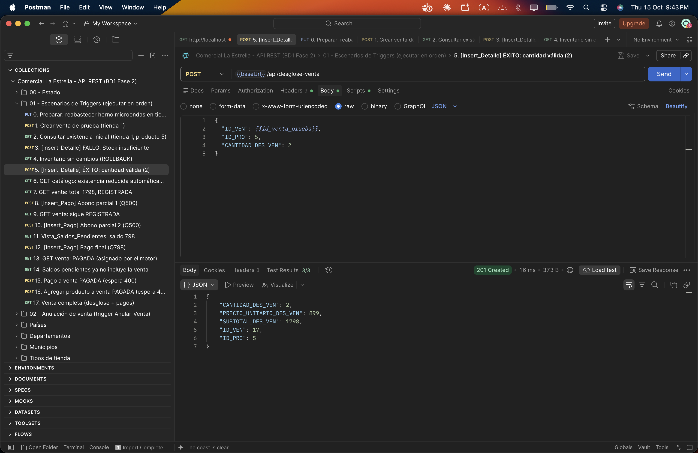
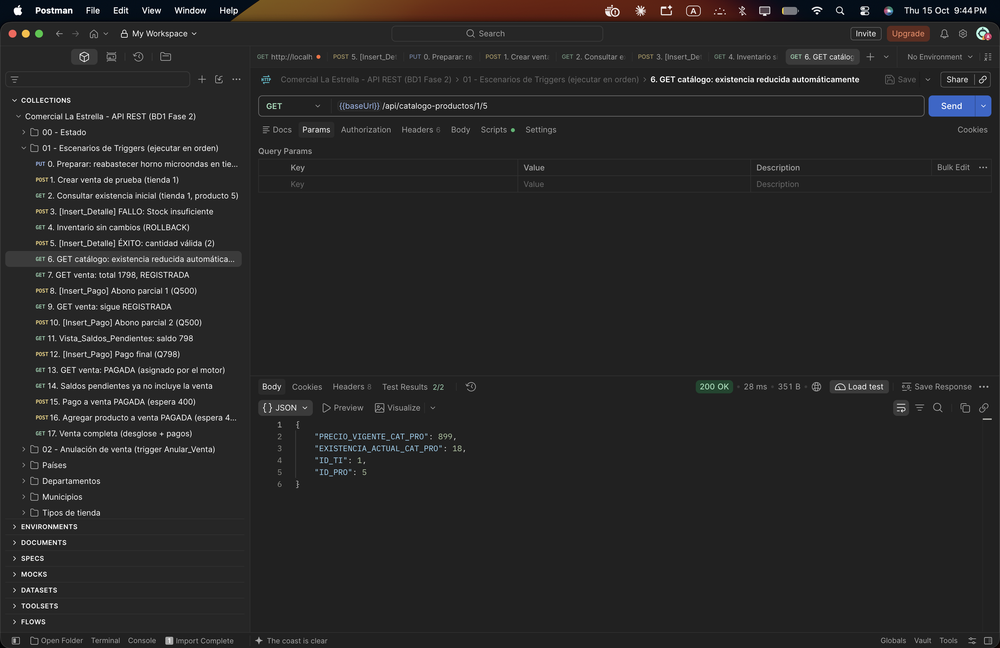

# Comercial La Estrella — Proyecto Fase 2 (BD1, 2S2026)

Backend para la base de datos **Comercial La Estrella**: SQL Server 2022 en Docker, inicializado automáticamente con `init.sql`, y un API REST en Node.js/Express que es la única vía para manipular datos. Las reglas de negocio (inventario y estado de ventas) viven en **triggers** y los reportes en **vistas**.

- **Estudiante:** _[Nombre completo]_ — **Carné:** _[#carnet]_
- **Repositorio:** _[https://github.com/usuario/repositorio]_

---

## 1. Estructura del proyecto

```
.
├── docker-compose.yml        # SQL Server 2022 + inicialización + API
├── init.sql                  # Tablas, llaves, vistas, triggers, usuario del API y datos
├── .env.example              # Variables de entorno (copiar a .env)
├── api/
│   ├── Dockerfile
│   ├── package.json
│   └── src/
│       ├── server.js         # Arranque y conexión con reintentos
│       ├── app.js            # Express, middlewares
│       ├── config/db.js      # Conexión mssql (variables de entorno)
│       ├── routes/           # index.js (rutas) y crudRouter.js
│       ├── controllers/      # Un controlador por entidad + crud.factory.js + reportes
│       ├── middlewares/      # errorHandler.js (traduce errores del motor a HTTP)
│       └── utils/
├── postman/
│   └── ComercialLaEstrella.postman_collection.json
└── docs/capturas/            # Evidencias de los triggers
```

## 2. Modelo de datos



| Tabla | Notas |
|---|---|
| `Venta` | `estado` ∈ {REGISTRADA, PAGADA, ANULADA}. `total` lo calcula el motor a partir del detalle. |
| `DetalleVenta` | `precio_unitario` opcional (si no se envía se copia el precio del producto); `subtotal` es columna calculada. |
| `Producto` | `existencia_actual` con `CHECK (>= 0)`. |
| `Pago` | `metodo_pago` ∈ {EFECTIVO, TARJETA, TRANSFERENCIA, CHEQUE}. |

## 3. Requisitos

- Docker Desktop (o Docker Engine + Compose v2), mínimo 8 GB de RAM.
- Postman.
- Node.js 18+ (solo si se quiere ejecutar el API fuera de Docker).
- DBeaver (solo lectura, verificación estructural).

> **Mac con Apple Silicon (M1/M2/M3):** la imagen de SQL Server es amd64. Activar en Docker Desktop *Settings → General → "Use Rosetta for x86_64/amd64 emulation"*. El `docker-compose.yml` ya fija `platform: linux/amd64`.

## 4. Levantar el entorno (paso a paso)

```bash
# 1. Variables de entorno
cp .env.example .env          # Windows PowerShell: copy .env.example .env

# 2. Levantar todo (BD + inicialización + API)
docker compose up -d --build

# 3. Verificar
docker compose ps             # sqlserver "healthy", db-init "exited (0)", api "running"
docker logs estrella-db-init  # debe decir: init.sql ejecutado correctamente
curl http://localhost:3000/api/health
```

**¿Qué pasa al hacer `up`?**

1. `sqlserver` arranca SQL Server 2022; su *healthcheck* espera a que acepte conexiones.
2. `db-init` (mismo contenedor de SQL Server, solo usa `sqlcmd`) ejecuta `init.sql` **automáticamente**. Si la base ya existe, lo omite y los datos se conservan (volumen `sqlserver_data`).
3. `api` arranca solo cuando `db-init` terminó con éxito, y se conecta con las variables `DB_HOST`, `DB_USER`, `DB_PASSWORD`, etc.

**Reiniciar desde cero** (borra los datos y vuelve a ejecutar `init.sql`):

```bash
docker compose down -v && docker compose up -d --build
```

### Seguridad aplicada

- El API **no usa `sa`**: `init.sql` crea el login `api_estrella` con roles `db_datareader` y `db_datawriter` (puede leer/escribir datos, pero no modificar la estructura).
- Todas las consultas del API son parametrizadas y los nombres de columna salen de una lista blanca por entidad.

## 5. Ejecutar el API fuera de Docker (opcional)

Con la BD levantada (`docker compose up -d sqlserver db-init`):

```bash
cd api
cp .env.example .env
npm install
npm start            # o: npm run dev (recarga automática)
```

## 6. Endpoints

Base: `http://localhost:3000/api`

| Recurso | Ruta | DELETE |
|---|---|---|
| Países | `/paises` | físico |
| Departamentos | `/departamentos` | físico |
| Municipios | `/municipios` | físico |
| Categorías | `/categorias` | físico |
| Marcas | `/marcas` | físico |
| Tiendas | `/tiendas` | lógico (`activo = 0`) |
| Empleados | `/empleados` | lógico (`activo = 0`) |
| Clientes | `/clientes` | lógico (`activo = 0`) |
| Productos | `/productos` | lógico (`activo = 0`) |
| Ventas | `/ventas` | lógico (`estado = 'ANULADA'`, devuelve inventario) |
| Detalles de venta | `/detalles-venta` | físico (devuelve inventario) |
| Pagos | `/pagos` | físico (recalcula estado) |

Cada recurso tiene:

| Método | Ruta | Descripción |
|---|---|---|
| GET | `/recurso` | Lista todo. Acepta filtros: `?id_venta=3`, `?nit=CF` |
| GET | `/recurso/:id` | Busca por id (404 si no existe) |
| POST | `/recurso` | Crea. **Carga masiva:** enviar un arreglo JSON (se inserta en una transacción) |
| PUT | `/recurso/:id` | Actualiza los campos enviados |
| DELETE | `/recurso/:id` | Elimina (físico o lógico según la tabla) |

Extras:

| Método | Ruta | Descripción |
|---|---|---|
| GET | `/ventas/:id/completa` | Venta con su detalle y pagos |
| GET | `/reportes/ventas-ubicacion` | `SELECT * FROM Vista_Ventas_Ubicacion` |
| GET | `/reportes/top-productos` | `SELECT * FROM Vista_Top_Productos` |
| GET | `/reportes/saldos-pendientes` | `SELECT * FROM Vista_Saldos_Pendientes` |
| GET | `/health` | Estado del API y de la conexión |

### Códigos de respuesta

| Código | Cuándo |
|---|---|
| 200 / 201 | Éxito |
| 400 | Error de validación, regla de negocio del trigger (ej. `"Stock insuficiente"`), FK inexistente, CHECK, campo obligatorio |
| 404 | Registro o ruta inexistente |
| 409 | Valor único duplicado, o eliminar un registro referenciado |
| 503 | Sin conexión con la base de datos |

## 7. Lógica en el motor

### Trigger 1 — `Insert_Detalle` (AFTER INSERT en `DetalleVenta`)

1. Si la venta no está `REGISTRADA` → `RAISERROR` + `ROLLBACK`.
2. Agrupa `INSERTED` por producto y compara contra `existencia_actual`. Si se pide más de lo que hay → `RAISERROR('Stock insuficiente', 16, 1)` + `ROLLBACK TRANSACTION` (el detalle no queda guardado).
3. Si es válido: descuenta la cantidad del inventario, copia el precio del producto si no se envió y recalcula `Venta.total`.

### Trigger 2 — `Insert_Pago` (AFTER INSERT en `Pago`)

1. Rechaza pagos a ventas `ANULADA` o ya `PAGADA`.
2. Suma **todos** los pagos de la venta; si la suma `>= total` actualiza el estado a `PAGADA`.

### Triggers complementarios (consistencia del CRUD)

| Trigger | Función |
|---|---|
| `Update_Detalle` | Al cambiar cantidad/producto: devuelve lo anterior (`DELETED`), descuenta lo nuevo (`INSERTED`), valida stock y recalcula total |
| `Delete_Detalle` | Devuelve el inventario y recalcula el total |
| `Recalcular_Estado_Pago` | Al editar/eliminar un pago, recalcula PAGADA/REGISTRADA |
| `Anular_Venta` | Al anular una venta devuelve el inventario; impide reactivar una venta anulada |

### Cómo llega el error del trigger al API

Con `RAISERROR` + `ROLLBACK`, SQL Server envía el error **50000** (nuestro mensaje) seguido del **3609** ("la transacción terminó en el trigger"). `middlewares/errorHandler.js` revisa todos los errores (`err.precedingErrors`) y si encuentra uno `>= 50000` responde **HTTP 400** con ese mensaje:

```json
{ "error": "Stock insuficiente", "origen": "trigger" }
```

### Vistas

| Vista | Lógica |
|---|---|
| `Vista_Ventas_Ubicacion` | `Tienda → Municipio → Departamento → País` con `LEFT JOIN Venta` (condición `estado <> 'ANULADA'` dentro del `ON` para conservar tiendas sin ventas). `COUNT` y `SUM(total)` por tienda. |
| `Vista_Top_Productos` | `DetalleVenta` unido a ventas no anuladas, producto, categoría y marca. `SUM(cantidad)` y `SUM(cantidad * precio_unitario)`. |
| `Vista_Saldos_Pendientes` | Ventas `REGISTRADA`; los pagos se suman en una subconsulta (para no duplicar filas) y se unen con `LEFT JOIN`; `saldo = total − pagado`. |

## 8. Pruebas con Postman

1. Importar `postman/ComercialLaEstrella.postman_collection.json`.
2. La variable `baseUrl` ya apunta a `http://localhost:3000`.
3. Ejecutar la carpeta **"Escenarios de Triggers (ejecutar en orden)"** con el *Runner* (o petición por petición). Cada petición trae *tests* automáticos:

| # | Petición | Resultado esperado |
|---|---|---|
| 1 | Crear venta | 201, estado REGISTRADA, total 0 |
| 2 | GET producto 5 | guarda la existencia inicial |
| 3 | POST detalle con existencia + 1 | **400 "Stock insuficiente"** |
| 4 | GET producto 5 | existencia sin cambios (ROLLBACK) |
| 5 | POST detalle cantidad 2 | 201 |
| 6 | GET producto 5 | **existencia reducida en 2** |
| 7 | GET venta | total 1798.00 calculado por el motor |
| 8–10 | Dos abonos de Q500 | 201, la venta sigue REGISTRADA |
| 11 | Saldos pendientes | pagado 1000, saldo 798 |
| 12 | Pago final | 201 |
| 13 | GET venta | **estado PAGADA** |
| 14 | Saldos pendientes | la venta ya no aparece |
| 15 | Agregar producto a venta pagada | 400 |

El resto de carpetas contiene el CRUD completo de cada tabla, la carga masiva de clientes y los tres reportes.

## 9. Evidencias (capturas)

> Reemplazar con capturas propias de Postman.

**Escenario 1 — Stock insuficiente (400)**


**Escenario 2 — Detalle válido y existencia reducida**



**Escenario 3 — Abonos parciales y estado PAGADA**


**Vistas**


## 10. Verificación con DBeaver (solo lectura)

Nueva conexión SQL Server → Host `localhost`, puerto `1433`, base `ComercialLaEstrella`, usuario `sa` (contraseña de `.env`). En *Connection settings → General* marcar **"Read-only connection"**. Usarlo solo para revisar tablas, vistas y triggers; toda manipulación de datos se hace por el API.

## 11. Problemas comunes

| Síntoma | Solución |
|---|---|
| `sqlserver` se reinicia | Revisar que `SA_PASSWORD` cumpla la política (mayúscula, minúscula, número, símbolo, 8+ caracteres) y que Docker tenga ≥ 2 GB de RAM asignados |
| El puerto 1433 o 3000 está ocupado | Cambiar `DB_PORT` o `API_PORT` en `.env` |
| Cambié `init.sql` y no se aplica | El script solo corre si la base no existe: `docker compose down -v` y volver a levantar |
| `api` no arranca | `docker logs estrella-db-init` para ver el error del script |
