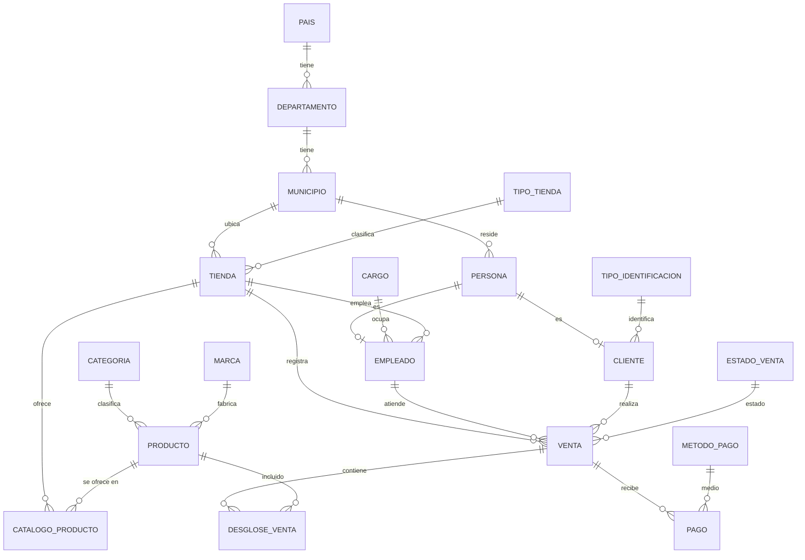
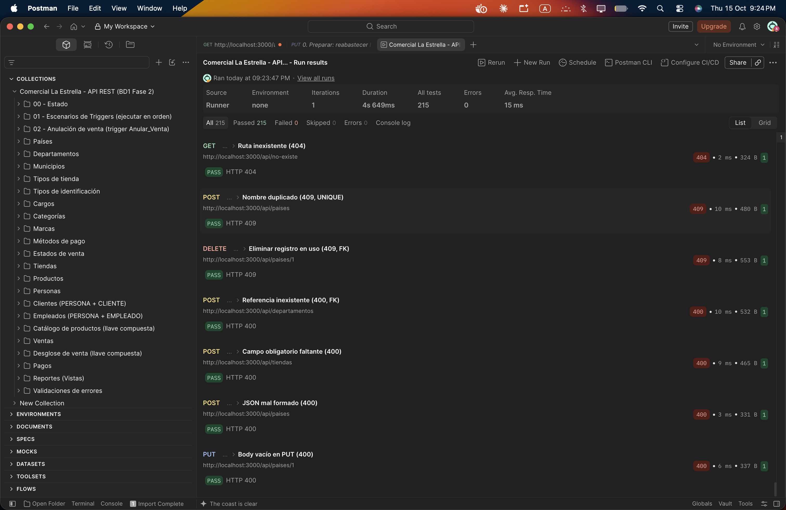

# Comercial La Estrella — Proyecto Fase 2 (BD1, 2S2026)

Backend para la base de datos **Comercial La Estrella**: SQL Server 2022 en Docker, inicializado automáticamente con `init.sql`, y un API REST en Node.js/Express que es la **única vía** para manipular datos. 

- **Estudiante:** Armando José Vásquez Castillo
- **Carné:** 202401451
- **Repositorio:** https://github.com/Vasquez005/SBD_B_F2_2S2026_202401451.git


---

## 1. Estructura del proyecto

```
.
├── docker-compose.yml          # SQL Server 2022 + inicialización + API
├── init.sql                    # Tablas, llaves, triggers, vistas, usuario del API y datos de prueba
├── .env.example                # Variables de entorno (copiar a .env)
├── api/
│   ├── Dockerfile
│   ├── package.json
│   └── src/
│       ├── server.js           # Arranque y conexión con reintentos
│       ├── app.js              # Express y middlewares
│       ├── config/db.js        # Conexión mssql, vars de entorno
│       ├── routes/             # index.js (todas las rutas) y crudRouter.js
│       ├── controllers/        # Un controlador por entidad + fábricas CRUD + reportes
│       ├── middlewares/        # errorHandler para manejor de errores
│       └── utils/
├── postman/
│   └── ComercialLaEstrella.postman_collection.json
└── docs/capturas/              # documentacion
```

## 2. Modelo de datos

El modelo es el aprobado en la Fase 1, traducido de Oracle a T-SQL



### Cambios de Oracle (Fase 1) a SQL Server (Fase 2)

| Oracle | SQL Server | Motivo |
|---|---|---|
| `NUMBER` (ids) | `INT IDENTITY(1,1)` | El motor genera los ids |
| `NUMBER(12,2)` / `NUMBER(10)` | `DECIMAL(12,2)` / `INT` | Tipos equivalentes |
| `VARCHAR2` | `NVARCHAR` | Soporte de tildes y ñ |
| `DATE` en `FECHA_VEN` | `DATETIME2(0)` | En SQL Server `DATE` no guarda la hora |
| `UNIQUE (CORREO_PER)` | Índice único filtrado `WHERE CORREO_PER IS NOT NULL` | En SQL Server un `UNIQUE` admite un solo NULL |
| Bloque PL/SQL de `DROP` | Eliminado | `docker compose down -v` reinicia la base |

## 3. Requisitos para poder ejecutar

- Docker Desktop con mínimo 8 GB de RAM.
- Postman
- Node.js 18+ para el backend
- DBeaver (solo lectura)

> **Mac con Apple Silicon:** la imagen de SQL Server es amd64. En Docker Desktop, activar *Settings → General → Use Rosetta for x86_64/amd64 emulation*. El `docker-compose.yml` ya fija `platform: linux/amd64`.

## 4. Levantar el entorno (paso a paso)

```bash
# 1. Variables de entorno
cp .env.example .env

# 2. Levantar todo (BD + inicialización + API)
docker compose up -d --build

# 3. Verificar
docker compose ps               # sqlserver "healthy", db-init "exited (0)", api "running"
docker logs estrella-db-init    # debe terminar con: init.sql ejecutado correctamente
curl http://localhost:3000/api/health
```

**Qué ocurre al hacer `up`:**

1. **`sqlserver`** arranca SQL Server 2022. Su *healthcheck* espera a que acepte conexiones.
2. **`db-init`** ejecuta `init.sql` automáticamente con `sqlcmd`. Si la base ya existe, lo omite y los datos se conservan en el volumen `sqlserver_data`.
3. **`api`** arranca solo cuando `db-init` terminó con éxito y se conecta mediante variables de entorno (`DB_HOST=sqlserver`, `DB_USER`, `DB_PASSWORD`…).

**Reiniciar desde cero** (borra los datos y vuelve a ejecutar `init.sql`):

```bash
docker compose down -v && docker compose up -d --build
```

## 5. Endpoints

Base: `http://localhost:3000/api`. El índice completo está en `GET /api/`.

| Recurso | Ruta | Llave | DELETE |
|---|---|---|---|
| Países | `/paises` | `ID_PA` | físico |
| Departamentos | `/departamentos` | `ID_DEP` | físico |
| Municipios | `/municipios` | `ID_MUN` | físico |
| Tipos de tienda | `/tipos-tienda` | `ID_TIP_TIE` | físico |
| Tipos de identificación | `/tipos-identificacion` | `ID_TIP_IDE` | físico |
| Cargos | `/cargos` | `ID_CAR` | físico |
| Categorías | `/categorias` | `ID_CAT` | físico |
| Marcas | `/marcas` | `ID_MAR` | físico |
| Estados de venta | `/estados-venta` | `ID_ES_VEN` | físico (los 4 estados base están protegidos) |
| Métodos de pago | `/metodos-pago` | `ID_MET_PAG` | físico |
| Tiendas | `/tiendas` | `ID_TI` | físico |
| Productos | `/productos` | `ID_PRO` | físico |
| Personas | `/personas` | `ID_PER` | físico |
| Clientes | `/clientes` | `ID_CLI` | físico (también borra su PERSONA) |
| Empleados | `/empleados` | `ID_EMP` | físico (también borra su PERSONA) |
| Catálogo de productos | `/catalogo-productos/:ID_TI/:ID_PRO` | compuesta | físico |
| Ventas | `/ventas` | `ID_VEN` | **lógico**: estado ANULADA y devuelve el inventario |
| Desglose de venta | `/desglose-venta/:ID_VEN/:ID_PRO` | compuesta | físico (devuelve el inventario) |
| Pagos | `/pagos` | `ID_PAG` | físico (recalcula el estado) |

Cada recurso tiene:

| Método | Ruta | Descripción |
|---|---|---|
| GET | `/recurso` | Lista todo. Acepta filtros por columna: `?ID_TI=1` |
| GET | `/recurso/:id` | Busca por llave (404 si no existe) |
| POST | `/recurso` | Crea. **Carga masiva:** enviar un arreglo JSON (todo en una transacción) |
| PUT | `/recurso/:id` | Actualiza los campos enviados |
| DELETE | `/recurso/:id` | Elimina (físico o lógico) |

Detalles relevantes:

- **Clientes y empleados** reciben un JSON plano con los datos de `PERSONA` y los propios. El API inserta `PERSONA` y luego `CLIENTE`/`EMPLEADO` en **una sola transacción**: si falla uno, se revierten ambos.
- **Desglose de venta:** el API completa `PRECIO_UNITARIO_DES_VEN` con el precio vigente del catálogo de la tienda de la venta y calcula `SUBTOTAL_DES_VEN`. Son `NOT NULL` y el `CHECK` del subtotal se evalúa antes del trigger.
- **Ventas:** `GET` agrega `ESTADO`, `TOTAL` (suma del desglose) y `PAGADO`. El estado PAGADA no se puede asignar por API; solo lo pone el motor.

| Extra | Descripción |
|---|---|
| `GET /ventas/:ID_VEN/completa` | Venta con su desglose y sus pagos |
| `GET /reportes/ventas-ubicacion` | `SELECT * FROM Vista_Ventas_Ubicacion` |
| `GET /reportes/top-productos` | `SELECT * FROM Vista_Top_Productos` |
| `GET /reportes/saldos-pendientes` | `SELECT * FROM Vista_Saldos_Pendientes` |
| `GET /health` | Estado del API y de la conexión |

### Códigos de respuesta

| Código | Cuándo |
|---|---|
| 200 / 201 | Éxito |
| 400 | Regla de negocio de un trigger (ej. `"Stock insuficiente"`), validación, FK inexistente, CHECK, campo obligatorio, JSON inválido |
| 404 | Registro o ruta inexistente |
| 409 | Valor único duplicado, o eliminar un registro referenciado |
| 503 | Sin conexión con la base de datos |

## 6. Lógica en el motor

### Trigger 1: `Insert_Detalle` (AFTER INSERT en `DESGLOSE_VENTA`)

1. Si la venta no está `REGISTRADA`, ejecuta `RAISERROR` + `ROLLBACK`.
2. Agrupa `INSERTED` por (tienda de la venta, producto) y lo une con `CATALOGO_PRODUCTO`. Si la cantidad supera `EXISTENCIA_ACTUAL_CAT_PRO`, o el producto no está en el catálogo de esa tienda, ejecuta `RAISERROR('Stock insuficiente', 16, 1)` + `ROLLBACK TRANSACTION`, y la línea no queda guardada.
3. Si es válido, descuenta la cantidad del inventario de esa tienda.

### Trigger 2: `Insert_Pago` (AFTER INSERT en `PAGO`)

1. Rechaza pagos a ventas `ANULADA` o ya `PAGADA`.
2. Suma **todos** los pagos de la venta y los compara con el total (`SUM(SUBTOTAL_DES_VEN)`). Si pagado ≥ total, cambia el estado a `PAGADA`. Los ids de estado se buscan por nombre.

### Triggers complementarios

| Trigger | Función |
|---|---|
| `Update_Detalle` | Al cambiar una línea: devuelve lo anterior (`DELETED`), descuenta lo nuevo (`INSERTED`) y valida el stock |
| `Delete_Detalle` | Devuelve el inventario a la tienda |
| `Recalcular_Estado_Pago` | Al editar o eliminar un pago, recalcula PAGADA / REGISTRADA |
| `Anular_Venta` | Al anular una venta devuelve el inventario; impide reactivar una venta anulada |

**Conceptos clave:**

- Los triggers se disparan **una vez por sentencia**, no por fila. Por eso trabajan sobre `INSERTED`/`DELETED` con `JOIN` y `GROUP BY`.
- Corren **dentro de la transacción** del `INSERT`. Un `ROLLBACK` deshace también la fila que lo disparó.

### Cómo llega el error del trigger al API

Con `RAISERROR` + `ROLLBACK`, SQL Server envía el error **50000** (el mensaje) seguido del **3609** ("la transacción terminó en el trigger"). `middlewares/errorHandler.js` recorre todos los errores (`err.precedingErrors`) y, si encuentra uno ≥ 50000, responde **HTTP 400**:

```json
{ "error": "Stock insuficiente", "origen": "trigger" }
```

### Vistas

Una vista no guarda datos: se recalcula en cada consulta. Como el modelo no almacena el total de la venta, se calcula como `SUM(SUBTOTAL_DES_VEN)`.

| Vista | Lógica |
|---|---|
| `Vista_Ventas_Ubicacion` | `TIENDA → MUNICIPIO → DEPARTAMENTO → PAIS` con `LEFT JOIN` a las ventas no anuladas (pre-agregadas con su total), para incluir tiendas sin ventas. `COUNT` y `SUM` por tienda. |
| `Vista_Top_Productos` | `DESGLOSE_VENTA` unido a ventas no anuladas, producto, categoría y marca. `SUM(CANTIDAD_DES_VEN)` y `SUM(SUBTOTAL_DES_VEN)`. El código es `ID_PRO`. |
| `Vista_Saldos_Pendientes` | Ventas `REGISTRADA`. Desglose y pagos se suman en **subconsultas separadas** (un JOIN directo duplicaría filas y alteraría las sumas) y se unen con `LEFT JOIN`. Saldo = total − pagado. |

## 7. Pruebas con Postman

1. Importar `postman/ComercialLaEstrella.postman_collection.json` (**File → Import**).
2. La variable `baseUrl` ya apunta a `http://localhost:3000`.
3. Ejecutar la colección con el **Runner**. Resultado: **215 tests, 0 fallidos**.



La carpeta **01 - Escenarios de Triggers** reproduce los escenarios de la sección 3.2-B:

| Paso | Petición | Resultado |
|---|---|---|
| 0–2 | Reabastecer, crear venta y leer existencia | Venta REGISTRADA |
| 3 | `POST /desglose-venta` con existencia + 1 | **400 "Stock insuficiente"** |
| 4 | `GET /catalogo-productos/1/5` | Existencia sin cambios (ROLLBACK) |
| 5 | `POST /desglose-venta` con cantidad 2 | **201** |
| 6 | `GET /catalogo-productos/1/5` | **Existencia reducida en 2** |
| 7 | `GET /ventas/:id` | Total 1798, REGISTRADA |
| 8–10 | Dos abonos de Q500 | 201, sigue REGISTRADA |
| 11 | Saldos pendientes | Pagado 1000, saldo 798 |
| 12–13 | Pago final de Q798 y `GET /ventas/:id` | **ESTADO = PAGADA** |
| 14–17 | Saldos, pago extra, producto extra, venta completa | Fuera de la vista; 400; 400; detalle completo |

El resto de carpetas cubre el CRUD de las 19 tablas, la carga masiva, la atomicidad de clientes, la anulación de ventas, los reportes y la validación de errores.


## 8. Verificación con DBeaver (solo lectura)

1. Crear una conexión SQL Server con host `localhost`, puerto `1433`, base `ComercialLaEstrella`, usuario `sa` y la contraseña de `.env`.
2. En **Driver properties**, poner `trustServerCertificate = true`.
3. En **Edit Connection → General**, marcar **Read-only connection**.

Se usa únicamente para revisar tablas, vistas y triggers. Toda manipulación de datos se hace por el API.